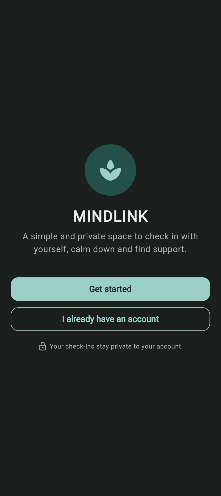
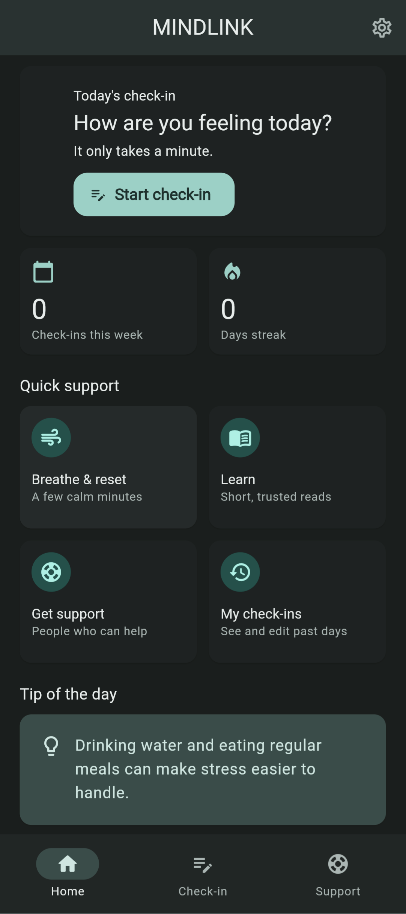
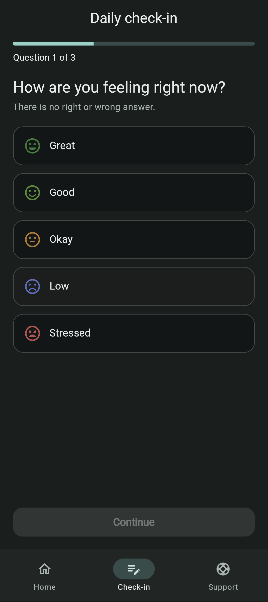
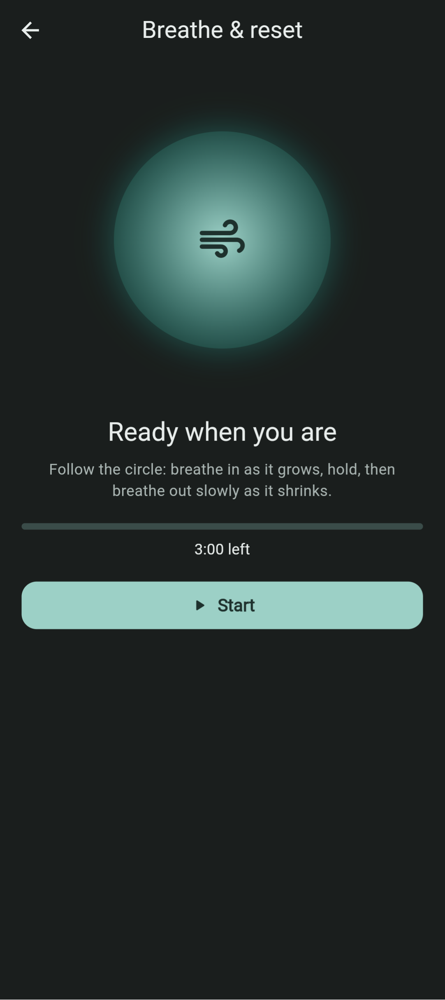

# MINDLINK

A simple and private well-being app for university students in Rwanda. Students do a short daily mood check-in, use a guided breathing exercise, read short trusted articles and find support.

ALU Summative Project – Group 24: Uwera Noella and Kenny Gatete.

## Features

- Email/password and Google sign-in, password reset, email verification
- 3-step daily check-in with a suggestion based on the answers
- Check-in history: create, read, update and delete (Firestore)
- Breathe & reset animation with a timer
- Support options: trusted person, counselling, urgent help
- Short articles about stress, deadlines, sleep and asking for help
- Settings saved on the device: theme, text size, breathing length, privacy mode
- Works on small and large phones and in landscape

## Tech stack

Flutter · Riverpod (state management) · Firebase Auth · Cloud Firestore · SharedPreferences

## Project structure

```
lib/
  core/        theme, routes, shared widgets, utilities
  features/    auth, check_in, home, breathe, support, learn, settings, shell
               each split into domain/ data/ presentation/
test/
  unit/        logic and repository tests
  widget/      screen tests
```

## Setup

1. Install Flutter and run `flutter doctor`.
2. Clone the repo:
   ```bash
   git clone https://github.com/Noella799/mindlink.git
   cd mindlink
   flutter pub get
   ```
3. Connect Firebase: `flutterfire configure` (Android + web), then enable Email/Password and Google sign-in and create a Firestore database.
4. Publish `firestore.rules` and create the index in `firestore.indexes.json` in the Firebase console.
5. Run the app:
   ```bash
   flutter run
   ```

## Tests

```bash
flutter analyze
flutter test --coverage
```

## Screenshots

| Welcome | Home | Check-in | Breathe |
|---|---|---|---|
|  |  |  |  |